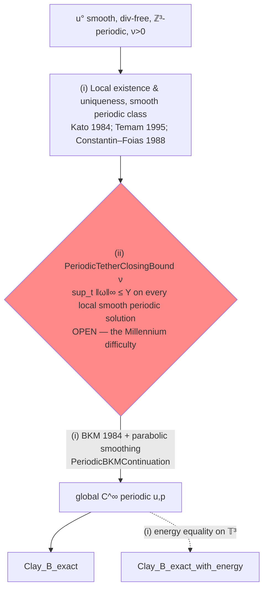

<!-- Copyright (c) 2026 Benjamin Stanley Frohman. Released under Apache 2.0 (see LICENSE). -->
# Clay (B) on 𝕋³ = ℝ³/ℤ³: exact statement and how far the Frohmanian chain reaches (trial, 2026-10-23)

**Status: Clay (B) is OPEN. Nothing here proves it.** This file is about a conditional
formalization. Lean: `NS_Millennium_Proof/Modules/ClayStatements.lean`.

## 1. Official statement (Fefferman, Clay 2000, verbatim, ASCII)
- (8) `u°(x + e_j) = u°(x)`, `f(x + e_j, t) = f(x, t)` for 1 ≤ j ≤ n. Erratum: "The further condition `p(x + e_j, t) = p(x, t)` should be made explicit in Eqn (8)."
- (9) `|∂_x^α ∂_t^m f(x,t)| ≤ C_{αmK}(1+|t|)^{-K}` on ℝ³×[0,∞), for any α, m, K.
- (10) `u(x,t) = u(x + e_j, t)` on ℝ³×[0,∞) for 1 ≤ j ≤ n.
- (11) `p, u ∈ C^∞(ℝⁿ×[0,∞))`.
- **(B)** "Take ν > 0 and n = 3. Let u°(x) be any smooth, divergence-free vector field satisfying (8); we take f(x,t) to be identically zero. Then there exist smooth functions p(x,t), u_i(x,t) on ℝ³×[0,∞) that satisfy (1), (2), (3), (10), (11)."
- **(D)** "…there exist a smooth, divergence-free vector field u°(x) on ℝ³ and a smooth f(x,t) on ℝ³×[0,∞), satisfying (8), (9), for which there exist no solutions (p,u) of (1), (2), (3), (10), (11) on ℝ³×[0,∞)."

Official (B) does **not** include the energy bound (7). On 𝕋³ it holds automatically for smooth periodic solutions, by the energy equality. `Clay_B_exact_with_energy` adds it, and `clay_B_exact_of_with_energy` proves it implies `Clay_B_exact`.

## 2. Lean names (all `Prop`s marked OPEN unless "proved")
| Name | Kind |
|---|---|
| `latticeVec`, `IsZ3Periodic`, `unitCube` | defs |
| `isZ3Periodic_iff_unit_shifts` | **proved**: ℤ³ invariance ⇔ unit shifts (8)/(10) |
| `navier_stokes_eq_Ici` | (1)+(2) with one-sided ∂ₜ (`derivWithin … (Ici 0)`) and a force slot |
| `IsPeriodicSmoothSolution` | (1),(2),(3),(10)+p-erratum,(11), jointly C^∞ (`ContDiffOn ℝ ∞` on `[0,∞)×ℝ³`) |
| `Clay_B_exact`, `Clay_B_exact_with_energy`, `Clay_D_periodic` | OPEN |
| `Clay_B` (old) | deprecated: two-sided `deriv` sees t < 0 at t = 0; unit-shift periodicity. Otherwise the same |
| `library_huniq_unsatisfiable_at_zero`, `closing_bound_uniqueness_family_unsatisfiable` | **proved** (audit finding, §4) |
| `IsPeriodicSmoothSolutionOn`, `PeriodicTetherClosingBound` | def / OPEN |
| `PeriodicBKMContinuation` | classical hypothesis (class i) |
| `clay_B_exact_of_periodic_tether_bound` | **proved**: bound + BKM → `Clay_B_exact` |

Every proved theorem uses only `propext, Classical.choice, Quot.sound`.

## 3. Chain

**The chain stops at T.** All other arrows are classical, and the Lean step after T is plain composition.

## 4. Audit findings (proved in Lean)
1. **The library uniqueness binder is false.** `huniq` (in `global_regularity_for_NS`, `global_regularity_of_restart`, `frohmanian_global_regularity_of_closing_bound`) quantifies over fields that are smooth only in x. `NS_PDE` uses `deriv` in t, which is 0 where the field is not differentiable. So `v(t) = 𝟙[t>1]·e₀` with `p = 0` "solves" NS from `u° = 0`, and so does `v ≡ 0`. `library_huniq_unsatisfiable_at_zero` proves that no Kato witness satisfies the binder. `closing_bound_uniqueness_family_unsatisfiable` shows that the hypothesis family of `frohmanian_global_regularity_of_closing_bound` cannot all hold. Those theorems are therefore vacuous as stated. Fix: require joint time regularity in the uniqueness class, as `IsPeriodicSmoothSolutionOn` does.
2. **The library tether bound is false at u° = 0.** This is a remark, not yet formalized. Take `u = ⌊t⌋(−x₁, x₀, 0)` and `p = ⌊t⌋²(x₀²+x₁²)/2`. These satisfy `NS_PDE` with `u(0) = 0`, and `‖ω‖∞ = 2⌊t⌋` is unbounded. So `FrohmanianTetherBound 0 ν` is false. `PeriodicTetherClosingBound` avoids this by quantifying only over classical periodic solutions.
3. **The energy binder kills periodic data.** `Integrable ‖u°‖²` on ℝ³ forces a continuous ℤ³-periodic u° to vanish. The ℝ³ chain cannot be applied on 𝕋³ unchanged.

## 5. Hypotheses for `Clay_B_exact` and their class
| Hypothesis | Class | Reference |
|---|---|---|
| Local smooth periodic existence | (i) known | Kato 1984 (Math. Z. 187); Temam 1995 SIAM; Constantin–Foias 1988 |
| Uniqueness of smooth periodic solutions (time-regular class) | (i) known (energy method) | Temam; Constantin–Foias |
| BKM continuation + parabolic smoothing to C^∞ in (t,x) | (i) known | Beale–Kato–Majda 1984 (CMP 94) |
| Energy equality on 𝕋³ (for `_with_energy`) | (i) known | Temam; Constantin–Foias |
| `PeriodicTetherClosingBound` (uniform ‖ω‖∞) | **(ii) OPEN** | equivalent in difficulty to (B) itself |

## 6. Is there a 𝕋³ advantage in the user's works?
Script: `scripts/t3_advantage_check.py` (output in `.out.txt`).
- **Finite energy and Poincaré.** Mean-zero fields satisfy Ω ≥ 4π²E, so E(t) ≤ E(0)e^{−8π²νt}. This is classical and gives global regularity for *small* data or after a waiting time. It does not give a large-data ‖ω‖∞ bound.
- **Integer rescaling survives on 𝕋³.** u_ℓ(x,t) = ℓu(ℓx, ℓ²t) with ℓ ∈ ℕ maps 1-periodic solutions to 1-periodic solutions at the same ν. Numerically on Taylor–Green, E scales as ℓ², Ω as ℓ⁴ and M as ℓ². So the supercritical gap of `SCALE_INVARIANT_TETHER.md` and `HWEIGHT_OBSTRUCTION.md` (only M′ ≲ M² is obtainable) carries over unchanged to 𝕋³.
- **Discrete spectrum** gives compactness (Galerkin, Leray–Hopf weak solutions). That is classical and yields weak solutions only.
- **Tether, comparison ODE and Uniqueness.** The comparison lemma (`comparison_ode_stability`) would close the argument if M′ ≤ CM² − κ″M³ held. That inequality is the false or unproved rate (see `HWEIGHT_OBSTRUCTION.md`). Nothing in it is 𝕋³-specific.

**Verdict: I found no 𝕋³-specific mechanism in the current works that closes the bound.** The honest status is that `Clay_B_exact` is reduced in Lean to one named open Prop plus classical theorems. That is exactly where the field has stood since 1984, and it is not a solution.
